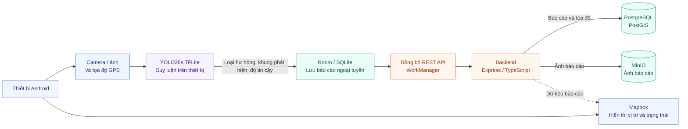

# Road Damage Management System

**Hệ thống phát hiện, định vị và quản lý hư hỏng mặt đường ứng dụng học sâu** — đồ án PBL5: Hệ thống máy tính, Trường Đại học Bách khoa – Đại học Đà Nẵng.

Repository bao gồm hai phần liên kết với nhau: **(1) nghiên cứu, huấn luyện và đánh giá YOLO26n/YOLO26s** trên tập con RDD2022; **(2) ứng dụng Android sử dụng mô hình YOLO26s TensorFlow Lite** để nhận diện hư hỏng, định vị và đồng bộ báo cáo với Backend.

## 1. Chức năng và kiến trúc



**Luồng chính:** Android nhận ảnh và GPS → YOLO26s TFLite nhận diện trực tiếp trên thiết bị → lưu báo cáo cục bộ → đồng bộ với Backend khi có kết nối. Backend lưu báo cáo/vị trí trong PostgreSQL/PostGIS, lưu ảnh trong MinIO; Mapbox hỗ trợ hiển thị bản đồ.

Ứng dụng sử dụng Kotlin/Jetpack Compose, CameraX, GPS, Mapbox, TensorFlow Lite và WorkManager; Backend cung cấp API xác thực, báo cáo và cập nhật trạng thái xử lý. [Chi tiết ứng dụng](app/README.md).

## 2. Dữ liệu nghiên cứu

Ảnh từ **RDD2022** (Nhật Bản, Trung Quốc, Ấn Độ) được chuẩn hóa thành ba lớp:

| ID | Tên lớp | Nhãn RDD2022 |
|---:|---|---|
| 0 | `pothole` | D40 |
| 1 | `linear_crack` | D00 + D10 |
| 2 | `alligator_crack` | D20 |

| Tập | Số ảnh | Bounding box GT |
|---|---:|---:|
| Train | 10.579 | 21.860 |
| Validation | 2.201 | 4.611 |
| Test | 2.196 | 4.548 |
| **Tổng** | **14.976** | **31.019** |

## 3. Cấu trúc repository

```text
Road-Damage-Management-System/
├── README.md
├── .gitignore
├── training/                 # LR Finder và các notebook huấn luyện
├── evaluation/               # Notebook và cấu hình đánh giá Test
├── models/                   # YOLO26n.pt, YOLO26s.pt
├── result/                   # Validation, Test, CSV/JSON/PNG và ví dụ
└── app/
    ├── README.md             # Tổng quan và cách vận hành hệ thống
    ├── android/              # Kotlin/Jetpack Compose + TFLite
    │   └── README.md
    └── backend/              # Express/TypeScript + PostGIS + MinIO
        └── README.md
```

## 4. Nghiên cứu và lựa chọn mô hình

1. Chuẩn hóa `data.yaml` và ba lớp nhãn; tách Train, Validation và Test.
2. Chạy LR Finder để xác định khoảng tốc độ học cần thử nghiệm (không dùng trọng số sau LR Finder làm khởi tạo cho huấn luyện chính).
3. Khảo sát năm LR với Linear Scheduler và so sánh Linear/Cosine tại hai LR trên **Validation**.
4. Cả **bốn notebook Linear/Cosine đang lưu** sử dụng `lr0=0.000667`; hai notebook Cosine bật `cos_lr=True`.
5. Cấu hình cuối được lựa chọn: **Linear Scheduler, `lr0=0.000667`**, cho cả YOLO26n và YOLO26s.
6. Dùng checkpoint đã chọn để đánh giá trên tập Test độc lập.

Tệp `result/hyperparameter_tuning/hyperparameter_tuning.csv` lưu cả các LR khảo sát (`0.0003`, `0.000667`, `0.001`, `0.0013`, `0.002`), **không phải** LR ban đầu của bốn notebook Linear/Cosine đang lưu. Chuỗi `0-00067` trong đường dẫn checkpoint Kaggle là **tên thư mục**, không thay thế giá trị `lr0` trong code.

## 5. Kết quả trên tập Test

| Mô hình | Precision | Recall | mAP50 | mAP50–95 |
|---|---:|---:|---:|---:|
| YOLO26n | 68,05% | 59,46% | 64,94% | 32,82% |
| YOLO26s | 69,16% | 60,77% | 66,45% | 33,45% |

Nguồn: `result/YOLO26n/metrics/metrics.json` và `result/YOLO26s/metrics/metrics.json`, số hiển thị đã được làm tròn.

**Phân biệt các giao thức:** Precision/Recall/mAP tổng thể được lấy từ `model.val()` chính thức. Ma trận nhầm lẫn 4 × 4 và phân tích theo ảnh dùng `conf=0.25`, NMS IoU `0.45` và matching IoU `0.50`; không suy ra trực tiếp chỉ số mAP từ các ô của ma trận.

## 6. Xem mã nguồn và chạy thử

- [Training](training/README.md) — các notebook và cấu hình huấn luyện.
- [Evaluation](evaluation/README.md) — quy trình đánh giá và các ngưỡng.
- [Models](models/README.md) — checkpoint của hai mô hình.
- [Results](result/README.md) — CSV/JSON/PNG và ví dụ dự đoán.
- [Ứng dụng Android + Backend](app/README.md) — quy trình chạy hệ thống.
- [Android](app/android/README.md) — cấu hình Android Studio, token Mapbox và kết nối API.
- [Backend](app/backend/README.md) — Docker Compose, biến môi trường và tài khoản quản lý.

