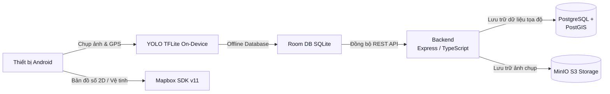

# Ứng dụng Road Damage Management System

Thư mục `app/` chứa **ứng dụng Android** và **Backend** để ghi nhận, định vị và quản lý các báo cáo hư hỏng mặt đường. Mô hình nhận diện chạy **trên điện thoại**; Backend nhận báo cáo và lưu trữ thông tin, ảnh và tọa độ.

## Cấu trúc thư mục `app/`

```text
app/
├── README.md                     # Tổng quan ứng dụng
├── android/                      # Ứng dụng Android
│   ├── README.md                 # Cấu hình và cách chạy Android
│   ├── app/                      # Mã nguồn Kotlin và model TFLite
│   ├── gradle/                   # Gradle wrapper
│   ├── build.gradle.kts          # Cấu hình build cấp dự án
│   └── settings.gradle.kts       # Cấu hình module và repository
└── backend/                      # Dịch vụ API và lưu trữ
    ├── README.md                 # Cấu hình và cách chạy Backend
    ├── src/                      # Mã nguồn TypeScript
    ├── package.json              # Dependency và npm scripts
    ├── Dockerfile                # Docker image Backend
    └── docker-compose.yml        # Các dịch vụ phát triển
```

## Thành phần

| Thành phần | Công nghệ trong mã nguồn | Vai trò |
|---|---|---|
| [`android/`](android/README.md) | Kotlin, Jetpack Compose, CameraX, TensorFlow Lite, GPS, Room, WorkManager, Mapbox | Thu nhận ảnh, suy luận, lưu cục bộ, hiển thị bản đồ và đồng bộ |
| [`backend/`](backend/README.md) | Node.js, Express, TypeScript, TypeORM, PostgreSQL/PostGIS, MinIO | Xác thực, quản lý báo cáo, ảnh và vị trí |

## Kiến trúc hệ thống



### Công nghệ chính

- **Mobile Client:** Kotlin, Jetpack Compose, Material 3 và CameraX.
- **Inference Engine:** YOLO26s xuất sang TensorFlow Lite, thực hiện suy luận trên thiết bị Android.
- **Lưu ngoại tuyến:** Room/SQLite; đồng bộ bằng WorkManager khi có điều kiện phù hợp.
- **Backend API:** Node.js, Express, TypeScript và TypeORM.
- **Cơ sở dữ liệu không gian:** PostgreSQL kết hợp PostGIS để quản lý vị trí báo cáo.
- **Lưu ảnh:** MinIO (tương thích API S3).
- **Bản đồ:** Mapbox SDK hiển thị bản đồ và các vị trí liên quan.

**Ba lớp nghiên cứu:** `pothole` (D40), `linear_crack` (D00 + D10), `alligator_crack` (D20). Lớp `linear_crack` là nứt tuyến tính gộp cả D00 và D10, không chỉ riêng nứt ngang. Một số *chú thích và nhãn tiếng Việt trong code Android* vẫn mô tả nhãn này là D10/nứt ngang; cần đồng bộ lại trước khi phát hành chính thức.

## Chạy thử ở môi trường phát triển

1. Cài Docker/Docker Compose; vào `app/backend/`, sao chép `.env.example` thành `.env` và thay **toàn bộ** các giá trị `CHANGE_ME` bằng giá trị riêng. Khởi chạy bằng `docker compose up --build -d` (chi tiết: [Backend README](backend/README.md)).
2. Mở thư mục `app/android/` bằng Android Studio. Tạo `local.properties` từ `local.properties.example`, cấu hình Mapbox token và `API_BASE_URL` rồi Sync Gradle (chi tiết: [Android README](android/README.md)).
3. Chạy ứng dụng trên emulator hoặc điện thoại, cấp quyền Camera/GPS, đăng nhập hoặc đăng ký tài khoản, thử tạo báo cáo và kiểm tra đồng bộ với Backend.

**Địa chỉ Backend:** Android Emulator dùng `http://10.0.2.2:3000/` khi Backend chạy trên máy host. Với điện thoại thật, dùng địa chỉ IP LAN hoặc HTTPS có thể truy cập từ điện thoại; `localhost`/`10.0.2.2` không hoạt động như nhau trên hai môi trường.

## Các tệp mô hình

- Mô hình được giữ trong mã nguồn Android: `android/app/src/main/assets/yolo26s_rdd_640.tflite`.


## Cấu hình và an toàn

- **Không commit** `backend/.env`, `android/local.properties`, mật khẩu cơ sở dữ liệu, JWT secret hay Mapbox Downloads Token.
- File `.env.example` và `local.properties.example` chỉ chứa mẫu cấu hình; không thay placeholder bằng khóa thật ngay trong file mẫu.
- Backend Docker Compose xuất cổng 3000, 5432, 9000 và 9001 trên máy chủ phát triển. Không triển khai trực tiếp ra Internet nếu chưa giới hạn mạng, cấu hình HTTPS, phân quyền và bảo vệ các dịch vụ.
- AndroidManifest hiện cho phép cleartext HTTP để thử nghiệm nội bộ; trước khi phát hành, nên ưu tiên HTTPS và tắt cấu hình này nếu không còn cần.

